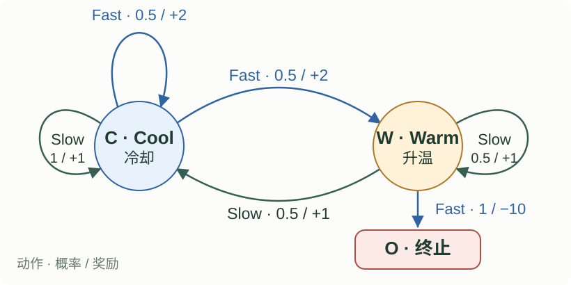
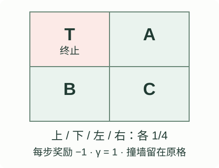
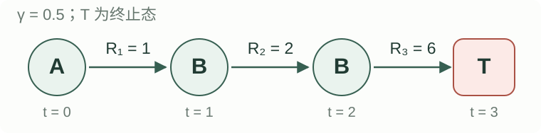
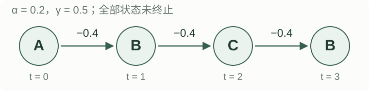
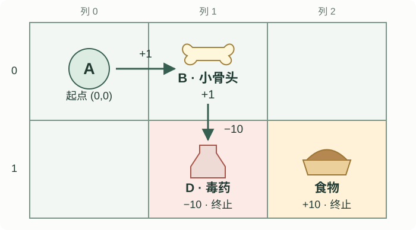

# 期中模拟卷

**满分 100 分**

## 一、单项选择题

**每题 1 分，共 16 分；每题只有一个正确选项。**

**1. 关于监督学习与强化学习，下列哪项正确？**

- A. 强化学习在每个状态都会收到正确动作标签。
- B. 监督学习通常使用输入与目标标签；强化学习通过交互奖励学习，动作可能影响未来数据和回报。
- C. 强化学习只优化当前一步奖励。
- D. 没有标签的任务都属于强化学习。

??? success "解答"

    **答案：B。**

    - **A 错误：** 强化学习通常收到奖励和下一状态，不会在每个状态获得“应该选哪个动作”的正确标签。
    - **B 正确：** 监督学习通常用输入与目标标签学习映射；强化学习通过与环境交互学习，当前动作还可能改变后续状态、采样数据和长期回报。
    - **C 错误：** 强化学习通常最大化期望累计回报。为了更高的未来收益，可以牺牲当前一步的奖励。
    - **D 错误：** 无监督学习也可以没有标签。强化学习的关键是智能体通过动作与环境交互，并利用奖励学习。

**2. 餐厅的平均服务质量逐渐变化，哪种估计更适合追踪近期变化？**

- A. 永久固定最初的估计。
- B. 只使用第一次访问的奖励。
- C. 使用固定正步长，让较旧奖励的权重逐渐衰减。
- D. 使用全部历史样本的等权平均，且样本越多，对变化的反应一定越快。

??? success "解答"

    **答案：C。**

    - **A 错误：** 永久固定初始估计就不会吸收新信息，无法追踪质量变化。
    - **B 错误：** 第一次访问只提供一个历史样本，既可能有噪声，也不能反映后续变化。
    - **C 正确：** 固定步长 $0<\alpha\leq1$ 的更新为 $Q_{n+1}=Q_n+\alpha(R_n-Q_n)$。展开后，较旧奖励的权重按 $(1-\alpha)$ 的幂衰减，因此更重视近期样本。
    - **D 错误：** 样本平均中新奖励的权重为 $1/n$。历史样本越多，单个新样本对估计的影响越小，对变化的反应通常越慢。

**3. MDP 的 Markov property 表示：**

- A. 下一状态与当前状态无关。
- B. 给定当前状态和动作后，下一状态与奖励的条件分布不再依赖更早历史。
- C. 下一状态必须由当前动作唯一确定。
- D. 所有状态都应得到相同奖励。

??? success "解答"

    **答案：B。**

    - **A 错误：** Markov 性并未排除当前状态的作用；下一状态通常正是由当前状态和动作共同决定其分布。
    - **B 正确：** 给定 $S_t,A_t$ 后，更早的状态、动作和奖励历史不再为 $S_{t+1},R_{t+1}$ 的条件分布提供额外信息。
    - **C 错误：** Markov 性允许随机转移。同一个状态—动作对可以以不同概率到达多个后继状态。
    - **D 错误：** Markov 性不要求奖励相同；奖励可以依赖当前状态、动作和后继状态。

**4. 对任意价值表 $V$，定义两个算子：**

$$
\begin{aligned}
(\mathcal A V)(s)&=\sum_a\pi(a\mid s)\sum_{s'}T(s,a,s')[R(s,a,s')+\gamma V(s')],\\
(\mathcal B V)(s)&=\max_a\sum_{s'}T(s,a,s')[R(s,a,s')+\gamma V(s')].
\end{aligned}
$$

- A. 两者都是 MC 更新。
- B. $\mathcal A$ 为最优算子，$\mathcal B$ 为期望算子。
- C. $\mathcal A=T^\pi$ 为固定策略的期望算子，$\mathcal B=T^*$ 为最优算子。
- D. 两者都必须等到一个回合结束才能计算。

??? success "解答"

    **答案：C。**

    - **A 错误：** 两式都利用转移与奖励模型，对所有后继分支求期望；MC 使用采样回合的实际回报。
    - **B 错误：** 名称颠倒了。$\mathcal A$ 按固定策略的动作概率加权，$\mathcal B$ 在动作期望中取最大值。
    - **C 正确：** $\mathcal A=T^\pi$ 是 Bellman 期望算子，用于固定策略评估；$\mathcal B=T^*$ 是 Bellman 最优算子，用于求最优价值。
    - **D 错误：** 已知模型和当前价值表，就能进行一步前瞻计算，不需要等待一个采样回合结束。

**5. 对固定策略预测，关于 MC 与 TD(0) 的目标，下列哪项正确？**

- A. 完整 MC 回报是无偏目标；TD 目标依赖当前后继估值，可能有偏，通常方差较低。
- B. MC 使用后继价值自举，TD 不使用。
- C. TD 目标有偏，所以表格 TD 永远不能收敛到正确价值。
- D. 在任何 MDP 中，TD 目标的方差都严格小于 MC。

??? success "解答"

    **答案：A。**

    - **A 正确：** 按固定策略采样的完整回报，其期望就是该策略的价值；TD(0) 用 $R_{t+1}+\gamma V(S_{t+1})$ 作目标，后继估值的误差可能引入偏差，通常也减少了长轨迹采样带来的方差。
    - **B 错误：** 两者恰好相反：标准 MC 不自举，TD 使用已有后继估值进行自举。
    - **C 错误：** 当前目标可能有偏不等于最终不能收敛。在适用的表格预测条件下，充分访问并采用合适步长，TD(0) 可以收敛到 $V^\pi$。
    - **D 错误：** “通常方差较低”不是对所有 MDP 的严格不等式。例如确定性转移、奖励和策略下，两种目标的方差都可以为 0。

**6. 下一状态非终止，行为策略实际选择了一个非贪心动作。哪项正确？**

- A. SARSA 必须忽略这个动作，改用最大 Q 值。
- B. SARSA 使用实际下一动作的 Q 值；Q-learning 使用下一状态的最大 Q 值。
- C. Q-learning 必须重新采样一个贪心动作后，才能更新当前表项。
- D. 只要行为策略是 ε-greedy，两个算法的目标就一定相同。

??? success "解答"

    **答案：B。**

    两种一步目标分别为：

    $$
    y_{\mathrm{SARSA}}=r+\gamma Q(s',a'),\qquad
    y_{\mathrm{Q}}=r+\gamma\max_b Q(s',b).
    $$

    - **A 错误：** SARSA 使用行为策略实际选出的下一动作 $a'$，包括探索时选出的非贪心动作。
    - **B 正确：** SARSA 代入实际下一动作的 Q 值；Q-learning 对下一状态的动作取最大 Q 值。
    - **C 错误：** Q-learning 可直接从当前 Q 表计算最大值，不必再执行或采样一个贪心动作。
    - **D 错误：** ε-greedy 仍可能选到非贪心动作。当 $\gamma>0$ 且该动作的 Q 值低于最大值时，两种目标就不同；特殊情况下可以相同。

**7. 在当前 Q 表不变、贪心动作唯一的情况下，增大 $\epsilon$ 通常会：**

- A. 增大折扣因子。
- B. 减小每次价值更新的步长。
- C. 增大非贪心动作的采样概率，增加探索，也可能降低短期收益。
- D. 保证当前每次行动都得到更高奖励。

??? success "解答"

    **答案：C。**

    - **A 错误：** 折扣因子是 $\gamma$，决定未来奖励的权重；改变 $\epsilon$ 不会自动改变 $\gamma$。
    - **B 错误：** 价值更新的步长由 $\alpha$ 控制，与探索参数 $\epsilon$ 是不同参数。
    - **C 正确：** 标准 ε-greedy 在 $m$ 个动作中均匀探索，每个非贪心动作的概率为 $\epsilon/m$。增大 $\epsilon$ 会增加探索，可能牺牲短期收益。
    - **D 错误：** 探索可能选择当前估值较低的动作，而且奖励可能随机，无法保证每次行动的即时奖励更高。

    **Exploration 与 Exploitation。** 利用是选择当前估值最高的动作；探索是尝试动作以获得信息，纠正不准确的估计。当前估值最高不等于真实收益最高，所以只利用可能一直错过更好的动作。

    **ε 如何影响学习表现：**

    | 探索设置 | 对采样和学习的影响 | 对收益的影响 |
    | --- | --- | --- |
    | $\epsilon=0$，纯贪心 | 不主动探索，早期低估的动作可能一直得不到修正 | 充分利用当前估计，但可能长期选择次优动作 |
    | 较大的 $\epsilon$ | 尝试更多动作，更容易发现被低估的动作或环境变化 | 学到好动作后仍频繁探索，可能降低短期平均奖励 |
    | 较小的正 $\epsilon$ | 更多利用，其他动作的采样机会较少 | 当前估计准确时可能有较高收益；估计错误时纠正较慢 |
    | 逐渐衰减的 $\epsilon_t$ | 早期收集信息，后期增加利用；衰减过快可能失去覆盖 | 有助于兼顾探索与利用，但不能仅凭衰减就保证最优 |

    **非平稳环境：** 奖励均值变化时，持续保留一定探索有助于重新发现最佳动作；固定步长 $\alpha$ 则让估计更重视近期奖励。$\epsilon$ 决定“采什么数据”，$\alpha$ 决定“用新数据改多少”，$\gamma$ 决定“未来奖励有多重要”。

**8. 有限 MDP、奖励有界、$0\leq\gamma<1$，同步 Value Iteration 的正确结论是：**

- A. 任意两轮得到相同贪心动作，就说明价值已精确收敛。
- B. 一轮更新就能得到 $V^*$。
- C. 同样的压缩系数结论可直接用于所有 $\gamma=1$ 任务。
- D. Bellman 最优算子为 $\gamma$-contraction，因此迭代收敛到唯一的 $V^*$。

??? success "解答"

    **答案：D。**

    - **A 错误：** 贪心动作可能在价值收敛前就保持不变。例如只有一个动作的状态，动作始终相同，但价值仍可能逐轮变化。
    - **B 错误：** 一轮通常只完成一次 Bellman backup；从任意初值出发，一般需要反复迭代才趋近 $V^*$。
    - **C 错误：** 当 $\gamma=1$ 时，系数不再严格小于 1，不能直接沿用折扣 MDP 的压缩映射结论；需额外分析任务条件。
    - **D 正确：** 在题设下，$\lVert T^*U-T^*V\rVert_\infty\leq\gamma\lVert U-V\rVert_\infty$。因此 $T^*$ 有唯一不动点 $V^*$，同步迭代收敛到它。

**9. 关于 $Q^\pi(s,a)$ 的含义，哪项正确？**

- A. 当前先执行指定动作 $a$，此后遵循策略 $\pi$ 的期望回报。
- B. 从当前时刻开始，每一步都必须选择最优动作。
- C. 只考虑执行 $a$ 后的即时奖励。
- D. 当前动作也必须先按 $\pi(\cdot\mid s)$ 随机选择，不能指定为 $a$。

??? success "解答"

    **答案：A。**

    $$
    Q^\pi(s,a)=\mathbb E_\pi[G_t\mid S_t=s,A_t=a].
    $$

    - **A 正确：** 条件中固定当前状态 $s$ 和当前动作 $a$；执行该动作后，后续动作遵循策略 $\pi$。
    - **B 错误：** $\pi$ 可以是任意待评估策略，不要求最优。当前动作也已指定，并非必须选最优动作。
    - **C 错误：** $G_t$ 包含即时奖励及后续折扣奖励，$Q^\pi$ 衡量的是期望累计回报。
    - **D 错误：** $Q^\pi(s,a)$ 正是条件在“当前执行 $a$”下的价值。对当前动作再按 $\pi$ 加权求和，得到的是 $V^\pi(s)$。

**10. 四个动作的当前 Q 值为 $(5,5,1,0)$。采用 $\epsilon=0.2$ 的 ε-greedy：探索时在全部动作中均匀选择，利用时在两个并列贪心动作中均匀选择。四个动作的概率是：**

- A. $(0.4,0.4,0.1,0.1)$
- B. $(0.5,0.5,0,0)$
- C. $(0.85,0.05,0.05,0.05)$
- D. $(0.45,0.45,0.05,0.05)$

??? success "解答"

    **答案：D。**

    有 $m$ 个动作、$g$ 个并列贪心动作时：

    $$
    \pi(a\mid s)=
    \begin{cases}
    (1-\epsilon)/g+\epsilon/m,&a\text{ 为贪心动作},\\
    \epsilon/m,&\text{其他动作}.
    \end{cases}
    $$

    代入 $m=4,g=2,\epsilon=0.2$：贪心动作各为 $0.8/2+0.2/4=0.45$，其他动作各为 $0.2/4=0.05$。

    - **A 错误：** $(0.4,0.4,0.1,0.1)$ 把全部探索概率只分给了两个非贪心动作；题目规定探索时在全部四个动作中均匀选择。
    - **B 错误：** $(0.5,0.5,0,0)$ 是在两个贪心动作间均匀利用，没有给非贪心动作探索概率。
    - **C 错误：** $(0.85,0.05,0.05,0.05)$ 把全部利用概率给了第一个动作；题目要求两个并列贪心动作平分利用概率。
    - **D 正确：** 两个贪心动作各获得 $0.4$ 的利用概率和 $0.05$ 的探索概率，其余动作各获得 $0.05$。

    **进入探索分支，不等于最后选到非贪心动作。** 探索时也可能随机抽到贪心动作。先列公式，再代入本题：

    $$
    P(\text{非贪心动作})=\epsilon\frac{m-g}{m}
    =0.2\times\frac{4-2}{4}=\boxed{0.1}.
    $$

    因此探索分支的概率是 $0.2$，最终选到非贪心动作的总概率是 $0.1$，最终选到贪心动作的总概率是 $0.9$。选到贪心动作时，无法仅凭这一结果判断来自利用还是探索；选到非贪心动作时，则一定来自探索分支。

**11. 一次转移获得奖励 $-2$ 后回合终止。$\gamma=0.9$，当前出发状态估值为 3。TD(0) 的正确 target 是：**

- A. $-2$
- B. $0$
- C. $-2+0.9\times3=0.7$
- D. $0.9\times(-2)=-1.8$

??? success "解答"

    **答案：A。**

    TD(0) 的目标公式为 $y=r+\gamma V(s')$。本次转移到终止态，代入得：

    $$
    y=-2+0.9\times0=\boxed{-2}.
    $$

    - **A 正确：** 到达终止态后无后续回报，目标只保留这次转移获得的奖励 $-2$。
    - **B 错误：** 终止态的后续价值为 0，不代表进入终止态时获得的奖励也是 0。
    - **C 错误：** 这里的 3 是出发状态的旧估值，不是后继价值。它应在 TD error $\delta=y-V(s)=-2-3=-5$ 中使用。
    - **D 错误：** 一步目标中的即时奖励 $R_{t+1}$ 不乘折扣；$\gamma$ 乘在后继价值上。

**12. 关于同步 Value Iteration 的一轮更新，哪项正确？**

- A. 更新完第一个状态后，后续状态必须读取它的新值。
- B. 每更新一个状态，就立即把它的所有后继状态也更新到收敛。
- C. 同步更新意味着只更新本轮实际访问到的一个状态。
- D. 全部状态的动作前瞻都读取上一轮 $V_k$，完成后统一得到 $V_{k+1}$。

??? success "解答"

    **答案：D。**

    - **A 错误：** 后续状态读取本轮刚更新的值属于 in-place 更新；同步更新统一读取上一轮的旧表。
    - **B 错误：** 一轮只对每个状态进行一次指定的 Bellman 更新，不要求先把所有后继状态单独更新至收敛。
    - **C 错误：** 同步 Value Iteration 对全部状态进行一次 sweep，不依赖某条实际采样轨迹只更新一个访问状态。
    - **D 正确：** 固定 $V_k$ 作为所有前瞻计算的输入，把结果写入 $V_{k+1}$；本轮的新值不参与本轮其他状态的计算。

**13. 在有限折扣 MDP 中，已精确求出 $V^\pi$。令 $\pi'(s)\in\arg\max_aQ^\pi(s,a)$，正确结论是：**

- A. 必须先知道 $Q^*$，才能进行这次策略改进。
- B. 应直接选择状态编号最大的后继，而不必考虑奖励和转移概率。
- C. 新策略满足 $V^{\pi'}(s)\geq V^\pi(s)$，但不保证每个状态都严格提高。
- D. 即使原策略已最优，新策略也必须在每个状态都严格提高价值。

??? success "解答"

    **答案：C。**

    贪心动作值至少不低于旧策略的动作加权平均：

    $$
    Q^\pi(s,\pi'(s))=\max_aQ^\pi(s,a)
    \geq\sum_a\pi(a\mid s)Q^\pi(s,a)=V^\pi(s).
    $$

    - **A 错误：** 用模型和已知的 $V^\pi$ 进行一步前瞻即可得到 $Q^\pi$，再据此改进策略；不需要预先知道 $Q^*$。
    - **B 错误：** 状态编号只是标识。策略改进需要比较动作的期望回报，必须考虑奖励、转移概率和后继价值。
    - **C 正确：** 由策略改进定理，新策略在每个状态的价值都不低于旧策略，但某些状态可以保持相同价值。
    - **D 错误：** 如果原策略已经最优，就没有更高的价值可达到；改进后仍可保持 $V^{\pi'}=V^\pi=V^*$。

**14. 对 $n$-step TD，若 $t+n=T$，即恰好在第 $n$ 步到达终止状态，目标应为：**

- A. $\displaystyle\sum_{k=0}^{n-1}\gamma^kR_{t+k+1}$
- B. $\displaystyle\sum_{k=0}^{n-1}\gamma^kR_{t+k+1}+\gamma^nV(S_t)$
- C. 只使用前 $n-1$ 个奖励，忽略最后一次奖励。
- D. 暂不更新，必须等待终止后的下一次转移。

??? success "解答"

    **答案：A。**

    一般的 $n$ 步目标包含前 $n$ 个折扣奖励和后继自举项。题设 $t+n=T$，终止态价值为 0，因此：

    $$
    G_{t:t+n}=\sum_{k=0}^{n-1}\gamma^kR_{t+k+1}.
    $$

    - **A 正确：** 求和保留 $R_{t+1}$ 到 $R_T$ 的全部 $n$ 个奖励，不再加入终止后的价值。
    - **B 错误：** 自举项应使用第 $n$ 步后继状态的价值，而非起点 $V(S_t)$；本题后继恰好终止，自举项为 0。
    - **C 错误：** 进入终止态的最后一次奖励 $R_T$ 仍属于回报，不能丢弃。
    - **D 错误：** 到达终止态时已观察到所需的全部奖励，可以计算目标，无需等待不存在的终止后转移。

**15. 关于探索衰减与 GLIE，下列哪项正确？**

- A. 从第一步起取 $\epsilon=0$，就能保证所有状态—动作对被充分访问。
- B. 固定正 $\epsilon$ 在存在严格非贪心动作时，必然满足 Greedy in the Limit。
- C. 只要 $\epsilon_t\to0$，任意 MDP 都自动满足 Infinite Exploration。
- D. 即使 $\epsilon_t\to0$，仍需检查相关状态—动作对是否被无限次访问。

??? success "解答"

    **答案：D。**

    - **A 错误：** $\epsilon=0$ 的纯贪心策略可能始终不选当前估值较低的动作，无法保证所有相关状态—动作对被充分访问。
    - **B 错误：** 固定正 $\epsilon$ 会持续给严格非贪心动作正概率，因此行为策略不会在极限中变为贪心策略。
    - **C 错误：** $\epsilon_t\to0$ 只描述探索概率趋于 0。若衰减太快，例如 $\epsilon_t=2^{-t}$，即使单状态 Bandit 也不能保证每个动作被无限次探索。
    - **D 正确：** GLIE 同时要求 Infinite Exploration 和 Greedy in the Limit。还需检查状态可达性及探索安排，保证相关状态—动作对被无限次访问。

    **为什么探索比例趋于 0，探索次数仍可以无限？** 以无限次决策的有限臂 Bandit 为例，每次独立随机选择是否探索，探索时均匀抽取全部 $m$ 个臂。第 $t$ 步通过探索分支选中指定臂的概率为 $\epsilon_t/m$。

    - 若 $\epsilon_t=1/t$，则 $\epsilon_t\to0$，且 $\sum_t\epsilon_t/m=\infty$。每个臂仍以概率 1 被无限次探索，同时非贪心动作的总概率趋于 0，满足 GLIE。
    - 若 $\epsilon_t=1/t^2$，虽然也趋于 0，但 $\sum_t\epsilon_t/m<\infty$，探索机制不再保证每个臂被无限次访问。
    - 若固定 $\epsilon>0$，上述 Bandit 会持续探索每个臂；但只要始终存在严格非贪心动作，策略就不会在极限中变为贪心。

    在一般 MDP 中，动作只有到达相应状态才能尝试。某个状态可能需要连续多次探索才能到达，因此不能把 Bandit 的 $1/t$ 结论直接当作所有 MDP 的访问保证。

**16. 某 Bandit 臂此前被选择 2 次，样本平均估计为 2。在全局第 10 步再次选择它，收到奖励 5。采用样本平均后，该臂的新估计为：**

- A. $2.3$
- B. $3$
- C. $5$
- D. $3.5$

??? success "解答"

    **答案：B。**

    样本平均按该臂的样本数更新：

    $$
    Q_{\mathrm{new}}=Q+\frac{R-Q}{N(a)}.
    $$

    代入更新后的计数 $N(a)=3$：

    $$
    Q_{\mathrm{new}}=2+\frac{5-2}{3}=\boxed{3}.
    $$

    - **A 错误：** $2.3=2+(5-2)/10$ 错把全局第 10 步当成了该臂的样本数。
    - **B 正确：** 该臂原有两个奖励的总和为 $2\times2=4$，加入奖励 5 后，平均为 $(4+5)/3=3$。
    - **C 错误：** 直接取 5 等于只保留最新奖励、使用步长 1，没有计算所有三次奖励的样本平均。
    - **D 错误：** $3.5=2+(5-2)/2$ 用了更新前的计数 2；加入本次奖励后分母应为 3。

## 二、填空题

**每题 3 分，共 24 分。三个空的题目每空 1 分；六个空的题目每空 0.5 分。**

**17. State Value、Action Value 与二者关系。** 对固定策略 $\pi$，$G_t$ 表示从时刻 $t$ 开始的折扣回报。分别补全以下三项：

**（1）State Value 定义：用回报 $G_t$ 的条件期望表示状态价值。**

$$
V^\pi(s)=\underline{\qquad\qquad}.
$$

**（2）Action Value 定义：给定当前状态 $s$ 和动作 $a$，用回报 $G_t$ 的条件期望表示动作价值。**

$$
Q^\pi(s,a)=\underline{\qquad\qquad}.
$$

**（3）V–Q 关系：用策略概率 $\pi(a\mid s)$ 和动作价值 $Q^\pi(s,a)$ 表示状态价值。**

$$
V^\pi(s)=\underline{\qquad\qquad}.
$$

??? success "解答"

    **（1）State Value 定义**

    $$
    V^\pi(s)=\mathbb E_\pi[G_t\mid S_t=s].
    $$

    从状态 $s$ 出发，包括当前动作在内，始终按策略 $\pi$ 行动时的期望回报。

    **（2）Action Value 定义**

    $$
    Q^\pi(s,a)=\mathbb E_\pi[G_t\mid S_t=s,A_t=a].
    $$

    当前先执行指定动作 $a$，之后按策略 $\pi$ 行动时的期望回报。

    **（3）V–Q 关系**

    $$
    V^\pi(s)=\sum_a\pi(a\mid s)Q^\pi(s,a).
    $$

    给定状态 $s$，策略以概率 $\pi(a\mid s)$ 选择动作 $a$，该动作对应的期望回报为 $Q^\pi(s,a)$。把各动作的价值按选择概率加权求和，就得到 $V^\pi(s)$。

    **（1）是状态价值的条件期望定义；（3）是同一个期望按当前动作展开的全期望公式。两式表达同一个 $V^\pi(s)$。**

**18. Soft policy。** 四个可用动作，$\epsilon=0.2$。ε-soft 对每个动作规定的概率下界是 \_\_\_\_\_\_；若贪心动作唯一，ε-greedy 赋予它的总概率是 \_\_\_\_\_\_；按蕴含方向排列 ε-greedy、ε-soft、soft：\_\_\_\_\_\_。

??? success "解答"

    **先列公式：** ε-soft 要求 $\pi(a\mid s)\geq\epsilon/m$；唯一贪心动作的 ε-greedy 概率为 $1-\epsilon+\epsilon/m$。

    **代入：** $0.2/4=\boxed{0.05}$；$1-0.2+0.2/4=\boxed{0.85}$。关系为 **ε-greedy ⇒ ε-soft ⇒ soft**（$\epsilon>0$）；反向一般不成立。

**19. DP / MC / TD。** 按“需要转移与奖励模型吗 / 使用已有价值自举吗”填写“是、否”：DP（\_\_\_\_\_\_ / \_\_\_\_\_\_）；标准 MC（\_\_\_\_\_\_ / \_\_\_\_\_\_）；TD(0)（\_\_\_\_\_\_ / \_\_\_\_\_\_）。

??? success "解答"

    DP：**是 / 是**；MC：**否 / 否**；TD(0)：**否 / 是**。这里 DP 指枚举模型分支的经典 full backup。

**20. MC 样本选择。** 同一回合多次访问状态 $s$，First-visit 使用 \_\_\_\_\_\_ 的回报，Every-visit 使用 \_\_\_\_\_\_ 的回报；标准 episodic MC 要在 \_\_\_\_\_\_ 后才能获得完整目标。

??? success "解答"

    当前回合**首次访问**；当前回合**每次访问**；**回合终止**。首次访问的判定在每个新回合重新开始。

**21. TD(0)。** 非终止转移 $(s,r,s')$ 的 target 为 $y=$ \_\_\_\_\_\_，TD error 为 $\delta=$ \_\_\_\_\_\_，更新后 $V(s)=$ \_\_\_\_\_\_（右侧使用更新前的值）。

??? success "解答"

    $$
    y=r+\gamma V(s'),\qquad
    \delta=y-V(s),\qquad
    V_{\mathrm{new}}(s)=V(s)+\alpha\delta.
    $$

**22. GLIE。** 两项条件分别是 \_\_\_\_\_\_、\_\_\_\_\_\_；固定 $\epsilon=0.2$ 的 ε-greedy 在存在严格非贪心动作时，是否满足“Greedy in the Limit”：\_\_\_\_\_\_。

??? success "解答"

    每个相关 $(s,a)$ **无限次访问**；策略在极限下**相对于当前 Q 趋于贪心**；固定 $\epsilon=0.2$ **不满足**后者。只令 $\epsilon_t\to0$，也不能自动保证所有相关状态—动作对的覆盖。

    **Infinite Exploration：** 记 $N_t(s,a)$ 为到时刻 $t$ 为止的访问次数，要求每个相关状态—动作对满足

    $$
    N_t(s,a)\longrightarrow\infty\qquad\text{（以概率 1）}.
    $$

    它保证每个动作持续获得经验；“每个动作至少试过一次”远远不够。

    **Greedy in the Limit：** 记当前贪心动作集合为 $\mathcal A_t^*(s)=\arg\max_aQ_t(s,a)$，要求

    $$
    \sum_{a\notin\mathcal A_t^*(s)}\pi_t(a\mid s)\longrightarrow0.
    $$

    它要求极限中把概率集中到当前估计的贪心动作上；有并列最大值时，可以在多个贪心动作之间分配概率。

    **固定 ε 的反例。** 若有 $m$ 个动作、$g<m$ 个贪心动作，非贪心动作总概率为 $\epsilon(m-g)/m$。例如 $m=4,g=1,\epsilon=0.2$：

    $$
    P(\text{非贪心动作})=0.2\times\frac34=\boxed{0.15}.
    $$

    该概率不会随学习自动降到 0，因此不满足极限贪心。GLIE 也不代替学习率条件：要保证相应表格控制算法收敛，还需合适的步长与任务条件。

**23. 学习率。** 对每个表项的第 $n$ 次更新，常见随机逼近条件是 $\sum_n\alpha_n=$ \_\_\_\_\_\_、$\sum_n\alpha_n^2$ \_\_\_\_\_\_；在 $\alpha_n=1/n$ 与固定 $\alpha_n=0.1$ 中，同时满足两条的是 \_\_\_\_\_\_。

??? success "解答"

    $$
    \sum_n\alpha_n=\boxed{\infty},\qquad
    \sum_n\alpha_n^2\boxed{<\infty}.
    $$

    符合的是 $\boxed{\alpha_n=1/n}$：调和级数发散，平方倒数级数收敛。固定 $0.1$ 的平方和发散。这些是有限表格、充分访问及适当任务条件下的步长条件，不能单独保证任意算法收敛。

**24. 稠密模型的计算复杂度。** 令 $n=|\mathcal S|,m=|\mathcal A|$。一次 VI sweep 为 \_\_\_\_\_\_；已构造 $P^\pi,r^\pi$ 后，一次固定策略评估 sweep 为 \_\_\_\_\_\_；采用一般稠密线性求解进行精确评估，再做一次贪心改进，一轮 PI 为 \_\_\_\_\_\_。

??? success "解答"

    $\boxed{O(n^2m)}$、$\boxed{O(n^2)}$、$\boxed{O(n^3+n^2m)}$。

    VI 遍历状态、动作和后继；固定策略评估使用已聚合的 $P^\pi$；PI 的最后一式包含稠密线性求解和全动作改进。若用 $K$ 次评估 sweep 近似求值，一轮相应为 $O(Kn^2+n^2m)$。总运行时间还要考虑迭代轮数。

## 三、计算题

**共 60 分。**

### 25. Bandits：餐厅选择（7 分） {#q25}

两个臂为 LG1、LG7。初始 $Q(\mathrm{LG1})=Q(\mathrm{LG7})=0$，计数均为 0。先按下面给定序列收集奖励：

| 全局步骤 | 餐厅 | 奖励 |
| ---: | --- | ---: |
| 1 | LG1 | 4 |
| 2 | LG7 | 2 |
| 3 | LG1 | 0 |
| 4 | LG7 | 6 |
| 5 | LG1 | 3 |

1. 使用按臂计数的样本平均，逐行列出 $N(\mathrm{LG1}),N(\mathrm{LG7}),Q(\mathrm{LG1}),Q(\mathrm{LG7})$。（3 分）
2. 根据最终估计，采用 $\epsilon=0.2$ 的 ε-greedy，求两家餐厅的选择概率。探索分支在两个臂中均匀选择。（1 分）
3. 若真实均值为 $q_*(\mathrm{LG1})=3,q_*(\mathrm{LG7})=5$，分别计算 $\epsilon=0.2$ 和 $\epsilon=0.6$ 时的下一步期望奖励及期望 regret；比较时固定上述最终 Q 估计。（1 分）
4. 独立地，仅对 LG1 的三个奖励从零开始使用固定 $\alpha=0.5$，列出三次估计。说明为何这更适合非平稳奖励。（2 分）

??? success "解答"

    **（1）公式。** 仅更新本次选中的臂，计数先加 1：

    $$
    N(a)\leftarrow N(a)+1,\qquad
    Q_{\mathrm{new}}(a)=Q(a)+\frac{R-Q(a)}{N(a)}.
    $$

    **代入并逐行填表：**

    | 步骤 | 被更新表项的计算 | $N_1$ | $N_7$ | $Q_1$ | $Q_7$ |
    | ---: | --- | ---: | ---: | ---: | ---: |
    | 0 | 初值 | 0 | 0 | 0 | 0 |
    | 1 | $0+(4-0)/1=4$ | 1 | 0 | 4 | 0 |
    | 2 | $0+(2-0)/1=2$ | 1 | 1 | 4 | 2 |
    | 3 | $4+(0-4)/2=2$ | 2 | 1 | 2 | 2 |
    | 4 | $2+(6-2)/2=4$ | 2 | 2 | 2 | 4 |
    | 5 | $2+(3-2)/3=7/3$ | 3 | 2 | $7/3$ | 4 |

    这里下标 1、7 表示 LG1、LG7。最终估计下 LG7 为唯一贪心臂。

    **（2）公式。**

    $$
    \pi(a^*)=1-\epsilon+\frac\epsilon m,\qquad
    \pi(a\ne a^*)=\frac\epsilon m.
    $$

    **代入：**

    $$
    \pi(\mathrm{LG7})=0.8+0.2/2=\boxed{0.9},\qquad
    \pi(\mathrm{LG1})=0.2/2=\boxed{0.1}.
    $$

    **（3）公式。**

    $$
    \mathbb E[R]=\sum_a\pi(a)q_*(a),\qquad
    \ell=\max_aq_*(a)-\mathbb E[R].
    $$

    本题 LG7 是唯一贪心臂，故 $\pi(\mathrm{LG1})=\epsilon/2$、$\pi(\mathrm{LG7})=1-\epsilon/2$。先代入真实均值，得到关于探索参数的表达式：

    $$
    \mathbb E[R]=\frac\epsilon2\times3+\left(1-\frac\epsilon2\right)\times5=5-\epsilon,
    \qquad \ell=5-(5-\epsilon)=\epsilon.
    $$

    **分别代入 ε：**

    | $\epsilon$ | $\pi(\mathrm{LG1})$ | $\pi(\mathrm{LG7})$ | 下一步期望奖励 | 期望 regret |
    | ---: | ---: | ---: | --- | --- |
    | 0.2 | 0.1 | 0.9 | $0.1(3)+0.9(5)=\boxed{4.8}$ | $5-4.8=\boxed{0.2}$ |
    | 0.6 | 0.3 | 0.7 | $0.3(3)+0.7(5)=\boxed{4.4}$ | $5-4.4=\boxed{0.6}$ |

    本题当前贪心臂恰好也是真实最优臂，因此增大探索会降低下一步期望奖励、增加 regret。但若当前估计错误或环境发生变化，更多探索可能帮助发现更好的动作，改善后续收益。这些单步数值不能推出“ε 越小，整个学习过程就一定越好”。regret 使用真实均值计算，不能用当前 Q 估计或单次奖励替代。

    **（4）公式。**

    $$
    Q_{\mathrm{new}}=Q+\alpha(R-Q).
    $$

    **代入：**

    $$
    0+0.5(4-0)=\boxed{2},\quad
    2+0.5(0-2)=\boxed{1},\quad
    1+0.5(3-1)=\boxed{2}.
    $$

    固定步长下，第 $i$ 个奖励在第 $n$ 次更新后的权重为 $\alpha(1-\alpha)^{n-i}$。旧奖励的权重随更新衰减，因此更容易追踪变化；较大步长也会使噪声影响更明显。

### 26. MDP：赛车的一步期望与折扣（7 分） {#q26}

赛车状态为 $C$（Cool）、$W$（Warm）和 $O$（Overheated）。在 $C,W$ 可选择 Slow 或 Fast；$O$ 为终止态，后续价值为 0。转移与即时奖励如下，**$\gamma=0.8$**；第 4 小问另给路径与折扣。

<figure class="slide-figure exam-figure" markdown="1">
{ .slide-zoom }
</figure>

| 状态 | 动作 | 后继状态 | 概率 | 奖励 |
| --- | --- | --- | ---: | ---: |
| $C$ | Slow | $C$ | 1 | 1 |
| $C$ | Fast | $C$ | 0.5 | 2 |
| $C$ | Fast | $W$ | 0.5 | 2 |
| $W$ | Slow | $C$ | 0.5 | 1 |
| $W$ | Slow | $W$ | 0.5 | 1 |
| $W$ | Fast | $O$ | 1 | −10 |

1. 写出本题的 MDP 五元组，说明 $O$ 的后续价值。（2 分）
2. 给定一张用于前瞻的价值表 $U(C)=4,U(W)=2,U(O)=0$，求四个 $q_U(s,a)$。这里 $U$ 是给定估计，不假设已等于某个策略的精确价值。（2 分）
3. 在 $C$ 以概率 $0.25$ 选 Fast、$0.75$ 选 Slow，求一次固定策略 backup $(T^\pi U)(C)$。（1 分）
4. 独立的两路径模型：路径 A 的奖励序列为 $[2]$，路径 B 为 $[0,0,8]$，之后均终止。求使两者回报相等的 $\gamma\in[0,1]$；分别判断 $\gamma=0.25,0.75$ 时选择哪条路径。（2 分）

??? success "解答"

    **（1）模型。** $\mathcal S=\{C,W,O\}$；$\mathcal A(C)=\mathcal A(W)=\{\mathrm{Slow},\mathrm{Fast}\}$；$T$ 与 $R$ 由题面转移表给出；$\gamma=0.8$。$O$ 无后续决策，$V(O)=0$。进入它时的 $-10$ 仍计入当前转移奖励。

    **（2）公式。**

    $$
    q_U(s,a)=\sum_{s'}T(s,a,s')[R(s,a,s')+\gamma U(s')].
    $$

    **代入：**

    $$
    \begin{aligned}
    q_U(C,\mathrm{Slow})&=1[1+0.8\times4]=\boxed{4.2},\\
    q_U(C,\mathrm{Fast})&=0.5[2+0.8\times4]+0.5[2+0.8\times2]=\boxed{4.4},\\
    q_U(W,\mathrm{Slow})&=0.5[1+0.8\times4]+0.5[1+0.8\times2]=\boxed{3.4},\\
    q_U(W,\mathrm{Fast})&=1[-10+0.8\times0]=\boxed{-10}.
    \end{aligned}
    $$

    Fast 的两条随机分支必须加权求和；环境后继不是由智能体自由挑选的动作。

    **（3）公式。**

    $$
    (T^\pi U)(s)=\sum_a\pi(a\mid s)q_U(s,a).
    $$

    **代入：**

    $$
    (T^\pi U)(C)=0.75\times4.2+0.25\times4.4=\boxed{4.25}.
    $$

    这是对给定 $U$ 的一次固定策略 backup，尚不能把结果称为精确 $V^\pi(C)$。

    **（4）公式。**

    $$
    G_0=\sum_{k=0}^{T-1}\gamma^kR_{k+1}.
    $$

    **代入并解方程：**

    $$
    G_A=2,\qquad G_B=0+\gamma\times0+\gamma^2\times8=8\gamma^2,
    $$

    $$
    2=8\gamma^2\quad\Rightarrow\quad\gamma^2=\frac14
    \quad\Rightarrow\quad\boxed{\gamma=0.5}.
    $$

    $\gamma=0.25$ 时，$G_B=8(0.25)^2=0.5<2$，选 **A**；$\gamma=0.75$ 时，$G_B=8(0.75)^2=4.5>2$，选 **B**。折扣越大，较晚的大奖励越有吸引力。

### 27. Value Iteration：逐轮价值表（8 分） {#q27}

赛车状态为 $C$（Cool）、$W$（Warm）和 $O$（Overheated）。在 $C,W$ 可选择 Slow 或 Fast；$O$ 为终止态，价值始终为 0。折扣 $\gamma=0.8$，初始 $V_0(C)=V_0(W)=V_0(O)=0$。转移与即时奖励如下：

<figure class="slide-figure exam-figure" markdown="1">
{ .slide-zoom }
</figure>

| 状态 | 动作 | 后继状态 | 概率 | 奖励 |
| --- | --- | --- | ---: | ---: |
| $C$ | Slow | $C$ | 1 | 1 |
| $C$ | Fast | $C$ | 0.5 | 2 |
| $C$ | Fast | $W$ | 0.5 | 2 |
| $W$ | Slow | $C$ | 0.5 | 1 |
| $W$ | Slow | $W$ | 0.5 | 1 |
| $W$ | Fast | $O$ | 1 | −10 |

1. 写出 Value Iteration 公式，做 **三轮同步更新**。每轮先列 Cool / Slow、Cool / Fast、Warm / Slow、Warm / Fast 的动作前瞻值，再填 $V_{k+1}(C),V_{k+1}(W)$。（5 分）
2. 从第三轮价值 $V_3$ 再做一步前瞻，提取贪心策略。（2 分）
3. 说明本题为什么收敛；仅凭前三轮贪心动作不变，能否断定数值已精确等于 $V^*$？（1 分）

??? success "解答"

    **（1）公式。**

    $$
    q_k(s,a)=\sum_{s'}T(s,a,s')[R(s,a,s')+\gamma V_k(s')],\qquad
    V_{k+1}(s)=\max_aq_k(s,a).
    $$

    **代入模型后，每轮都使用同一张旧表 $V_k$：**

    $$
    \begin{aligned}
    q_k(C,\mathrm{Slow})&=1+0.8V_k(C),\\
    q_k(C,\mathrm{Fast})&=2+0.4[V_k(C)+V_k(W)],\\
    q_k(W,\mathrm{Slow})&=1+0.4[V_k(C)+V_k(W)],\\
    q_k(W,\mathrm{Fast})&=-10.
    \end{aligned}
    $$

    | 使用旧表 | Cool / Slow | Cool / Fast | Warm / Slow | Warm / Fast |
    | --- | --- | --- | --- | ---: |
    | $V_0=(0,0)$ | $1+0.8(0)=1$ | $2+0.4(0+0)=2$ | $1+0.4(0+0)=1$ | −10 |
    | $V_1=(2,1)$ | $1+0.8(2)=2.6$ | $2+0.4(2+1)=3.2$ | $1+0.4(2+1)=2.2$ | −10 |
    | $V_2=(3.2,2.2)$ | $1+0.8(3.2)=3.56$ | $2+0.4(3.2+2.2)=4.16$ | $1+0.4(3.2+2.2)=3.16$ | −10 |

    **每个状态对动作取最大值，得到：**

    | 轮数 | $V_k(C)$ | $V_k(W)$ | $V_k(O)$ |
    | ---: | ---: | ---: | ---: |
    | 0 | 0 | 0 | 0 |
    | 1 | 2 | 1 | 0 |
    | 2 | 3.2 | 2.2 | 0 |
    | 3 | **4.16** | **3.16** | 0 |

    **（2）策略提取公式。**

    $$
    \pi_{V_3}(s)\in\arg\max_a\sum_{s'}T(s,a,s')[R(s,a,s')+\gamma V_3(s')].
    $$

    **代入第三轮的值：**

    $$
    \begin{aligned}
    q_3(C,\mathrm{Slow})&=1+0.8(4.16)=4.328,\\
    q_3(C,\mathrm{Fast})&=2+0.4(4.16+3.16)=4.928,\\
    q_3(W,\mathrm{Slow})&=1+0.4(4.16+3.16)=3.928,\\
    q_3(W,\mathrm{Fast})&=-10.
    \end{aligned}
    $$

    所以提取的策略为 **Cool → Fast，Warm → Slow**。

    **（3）收敛。** 在本题有限状态、有界奖励、$\gamma=0.8<1$ 的条件下：

    $$
    \|T^*u-T^*v\|_\infty\leq0.8\|u-v\|_\infty.
    $$

    因而同步迭代收敛到唯一 $V^*$。三轮后动作虽相同，再更新一轮仍得到 $(4.928,3.928)\ne(4.16,3.16)$，所以 $V_3$ 尚非不动点，不能把策略暂时稳定当作价值已收敛。

### 28. Policy Evaluation：GridWorld 与矩阵（8 分） {#q28}

考虑下图 $2\times2$ GridWorld：

<figure class="slide-figure exam-figure exam-figure-grid" markdown="1">
{ .slide-zoom }
</figure>

四个动作上、下、左、右各以概率 $1/4$ 选择；移动确定，撞墙留在原格。**每次从非终止状态出发的奖励均为 $-1$，包括进入 $T$；$\gamma=1$，$V(T)=0$。**

1. 按 $(A,B,C)$ 的顺序，列出非终止部分的 $P^\pi$ 和奖励向量 $r^\pi$。指出前两行概率和为什么不是 1。（2 分）
2. 从零开始做两轮同步策略评估，列出每轮完整的 $(V(A),V(B),V(C))$。（2 分）
3. 写出 $(I-\gamma P^\pi)v=r^\pi$，用代数消元求精确价值。说明本题 $\gamma=1$ 时，为什么仍可评估这个策略。（4 分）

??? success "解答"

    **（1）公式。** 固定策略下：

    $$
    P^\pi_{ij}=\sum_a\pi(a\mid s_i)T(s_i,a,s_j),\qquad
    r^\pi_i=\sum_a\pi(a\mid s_i)\sum_{s'}T(s_i,a,s')R(s_i,a,s').
    $$

    **代入四个等概率动作：**

    | 出发 | 上 | 下 | 左 | 右 |
    | --- | --- | --- | --- | --- |
    | $A$ | $A$ | $C$ | $T$ | $A$ |
    | $B$ | $T$ | $B$ | $B$ | $C$ |
    | $C$ | $A$ | $C$ | $B$ | $C$ |

    按 $(A,B,C)$ 排列，省略终止状态列：

    $$
    P^\pi=
    \begin{bmatrix}
    1/2&0&1/4\\
    0&1/2&1/4\\
    1/4&1/4&1/2
    \end{bmatrix},\qquad
    r^\pi=\begin{bmatrix}-1\\-1\\-1\end{bmatrix}.
    $$

    前两行的和为 $3/4$，剩余 $1/4$ 是进入 $T$ 的概率。完整转移矩阵的行和仍为 1；这里只保留非终止子矩阵。

    **（2）公式。**

    $$
    v_{k+1}=r^\pi+\gamma P^\pi v_k.
    $$

    **代入 $v_0=(0,0,0)^\top,\gamma=1$：**

    $$
    v_1=\begin{bmatrix}-1\\-1\\-1\end{bmatrix}
    +P^\pi\begin{bmatrix}0\\0\\0\end{bmatrix}
    =\begin{bmatrix}-1\\-1\\-1\end{bmatrix}.
    $$

    第二轮：

    $$
    \begin{aligned}
    V_2(A)&=-1+\tfrac12(-1)+\tfrac14(-1)=\boxed{-1.75},\\
    V_2(B)&=-1+\tfrac12(-1)+\tfrac14(-1)=\boxed{-1.75},\\
    V_2(C)&=-1+\tfrac14(-1)+\tfrac14(-1)+\tfrac12(-1)=\boxed{-2}.
    \end{aligned}
    $$

    | 轮数 | $V(A)$ | $V(B)$ | $V(C)$ | $V(T)$ |
    | ---: | ---: | ---: | ---: | ---: |
    | 0 | 0 | 0 | 0 | 0 |
    | 1 | −1 | −1 | −1 | 0 |
    | 2 | −1.75 | −1.75 | −2 | 0 |

    **（3）矩阵公式。**

    $$
    (I-\gamma P^\pi)v=r^\pi.
    $$

    **代入：**

    $$
    \begin{bmatrix}
    1/2&0&-1/4\\
    0&1/2&-1/4\\
    -1/4&-1/4&1/2
    \end{bmatrix}
    \begin{bmatrix}v_A\\v_B\\v_C\end{bmatrix}
    =\begin{bmatrix}-1\\-1\\-1\end{bmatrix}.
    $$

    两边乘 4，得到代数方程：

    $$
    2v_A-v_C=-4,\quad 2v_B-v_C=-4,\quad -v_A-v_B+2v_C=-4.
    $$

    前两式相减得 $v_A=v_B=x$；第三式给出 $v_C=x-2$。代回第一式：

    $$
    2x-(x-2)=-4\Rightarrow x=-6,\qquad v_C=-6-2=-8.
    $$

    因此 $\boxed{V^\pi(A)=V^\pi(B)=-6,\ V^\pi(C)=-8}$。每步奖励为 $-1$，它们分别对应期望还需 6、6、8 步终止。

    从任何非终止状态出发，都至少有 $1/8$ 的概率在接下来两步内终止：从 $C$ 可经上再左或左再上，两条路径总概率 $2(1/4)^2=1/8$；从 $A,B$ 下一步就有 $1/4$ 的终止概率。因此生存概率按两步区间至多以 $7/8$ 衰减，期望回合长度有限。本题靠终止结构保证价值有限与评估收敛，不能直接套用 $\gamma<1$ 的一步压缩结论。

### 29. Policy Improvement：赛车的最优策略（8 分） {#q29}

赛车状态为 $C$（Cool）、$W$（Warm）和 $O$（Overheated）。在 $C,W$ 可选择 Slow 或 Fast；$O$ 为终止态，后续价值为 0。折扣 $\gamma=0.8$，初始策略 $\pi_0$ 在 $C,W$ 都选择 Slow。转移与即时奖励如下：

<figure class="slide-figure exam-figure" markdown="1">
{ .slide-zoom }
</figure>

| 状态 | 动作 | 后继状态 | 概率 | 奖励 |
| --- | --- | --- | ---: | ---: |
| $C$ | Slow | $C$ | 1 | 1 |
| $C$ | Fast | $C$ | 0.5 | 2 |
| $C$ | Fast | $W$ | 0.5 | 2 |
| $W$ | Slow | $C$ | 0.5 | 1 |
| $W$ | Slow | $W$ | 0.5 | 1 |
| $W$ | Fast | $O$ | 1 | −10 |

1. 精确评估 $\pi_0$，列 Bellman 方程并求 $V^{\pi_0}(C),V^{\pi_0}(W)$。（2 分）
2. 根据这张旧策略价值表，列四个 $Q^{\pi_0}(s,a)$，做一次贪心改进得到 $\pi_1$。（2 分）
3. 对 $\pi_1$ 写出二维矩阵方程并求精确价值。（2 分）
4. 再比较全部动作，验证策略是否稳定，给出 $\pi^*$ 和 $V^*$。（2 分）

??? success "解答"

    **（1）策略评估公式。**

    $$
    V^{\pi_0}(s)=\sum_{s'}T(s,\pi_0(s),s')[R(s,\pi_0(s),s')+\gamma V^{\pi_0}(s')].
    $$

    **代入处处 Slow，记 $v_C=V^{\pi_0}(C),v_W=V^{\pi_0}(W)$：**

    $$
    v_C=1+0.8v_C\Rightarrow0.2v_C=1\Rightarrow\boxed{v_C=5},
    $$

    $$
    v_W=0.5(1+0.8v_C)+0.5(1+0.8v_W)
    =1+0.4(5)+0.4v_W,
    $$

    $$
    0.6v_W=3\Rightarrow\boxed{v_W=5}.
    $$

    **（2）改进公式。**

    $$
    Q^{\pi_0}(s,a)=\sum_{s'}T(s,a,s')[R(s,a,s')+\gamma V^{\pi_0}(s')],\quad
    \pi_1(s)\in\arg\max_aQ^{\pi_0}(s,a).
    $$

    **代入同一张旧策略价值 $(5,5)$：**

    | 状态 | Slow | Fast | 改进后动作 |
    | --- | --- | --- | --- |
    | $C$ | $1+0.8(5)=5$ | $2+0.4(5+5)=6$ | Fast |
    | $W$ | $1+0.4(5+5)=5$ | $-10+0.8(0)=-10$ | Slow |

    得 $\boxed{\pi_1(C)=\mathrm{Fast},\ \pi_1(W)=\mathrm{Slow}}$。这里的 6 是按旧策略后续行动的一步前瞻值，不是新策略的完整评估结果。

    **（3）矩阵公式。**

    $$
    (I-\gamma P^{\pi_1})v^{\pi_1}=r^{\pi_1}.
    $$

    **代入：**

    $$
    P^{\pi_1}=\begin{bmatrix}0.5&0.5\\0.5&0.5\end{bmatrix},\quad
    r^{\pi_1}=\begin{bmatrix}2\\1\end{bmatrix},
    $$

    $$
    \begin{bmatrix}0.6&-0.4\\-0.4&0.6\end{bmatrix}
    \begin{bmatrix}v_C\\v_W\end{bmatrix}
    =\begin{bmatrix}2\\1\end{bmatrix}.
    $$

    两式相减得 $v_C-v_W=1$；代回第一式：

    $$
    0.6(v_W+1)-0.4v_W=2\Rightarrow0.2v_W=1.4
    \Rightarrow\boxed{v_W=7,\ v_C=8}.
    $$

    也可核对逆矩阵：

    $$
    \begin{bmatrix}0.6&-0.4\\-0.4&0.6\end{bmatrix}^{-1}
    =\frac1{0.36-0.16}\begin{bmatrix}0.6&0.4\\0.4&0.6\end{bmatrix}
    =\begin{bmatrix}3&2\\2&3\end{bmatrix},
    $$

    $$
    \begin{bmatrix}3&2\\2&3\end{bmatrix}\begin{bmatrix}2\\1\end{bmatrix}
    =\begin{bmatrix}8\\7\end{bmatrix}.
    $$

    **（4）再次使用动作前瞻公式，代入新策略精确价值：**

    | 状态 | Slow | Fast | 贪心动作 |
    | --- | --- | --- | --- |
    | $C$ | $1+0.8(8)=7.4$ | $2+0.4(8+7)=8$ | Fast |
    | $W$ | $1+0.4(8+7)=7$ | $-10$ | Slow |

    策略不变，且当前价值满足 $V^{\pi_1}=T^*V^{\pi_1}$。由折扣 MDP 最优不动点的唯一性：

    $$
    \boxed{\pi^*(C)=\mathrm{Fast},\quad\pi^*(W)=\mathrm{Slow}},\qquad
    \boxed{V^*(C)=8,\quad V^*(W)=7,\quad V^*(O)=0}.
    $$

### 30. Monte Carlo：重复访问与 Soft Control（8 分） {#q30}

固定策略产生一条完整轨迹，$\gamma=0.5$：

<figure class="slide-figure exam-figure" markdown="1">
{ .slide-zoom }
</figure>

$S_0=A,S_1=B,S_2=B,S_3=T$，$T$ 为终止态。

1. 从后向前计算 $G_0,G_1,G_2,G_3$。（2 分）
2. 只用这一回合，分别计算 First-visit 与 Every-visit 对 $B$ 的估计；给出 $A$ 的估计。（2 分）
3. 现在改为加入历史样本：两种方法各自独立地已有 $N(B)=2,V(B)=4$。加入本回合后，分别用增量均值算出新的计数与价值。（2 分）
4. 独立的 MC control 更新：状态 $B$ 有动作 $a_1,a_2$，当前 $Q(B,a_1)=1,Q(B,a_2)=2$。刚收集到 $(B,a_1)$ 的完整回报 5，以 $\alpha=0.5$ 更新该表项，其他项暂不更新。随后用 $\epsilon=0.2$ 改进为 ε-greedy，求两动作概率，并说明它是否为 ε-soft。（2 分）

??? success "解答"

    **（1）公式。**

    $$
    G_t=R_{t+1}+\gamma G_{t+1},\qquad G_T=0.
    $$

    **从末尾向前代入：**

    $$
    G_3=0,\quad G_2=6+0.5(0)=\boxed{6},\quad
    G_1=2+0.5(6)=\boxed{5},\quad G_0=1+0.5(5)=\boxed{3.5}.
    $$

    **（2）公式。** 选出相应访问时刻的回报，再取样本平均：

    $$
    V(s)=\frac1{N(s)}\sum_{i=1}^{N(s)}G^{(i)}(s).
    $$

    **代入：** $B$ 的首次访问在 $t=1$，每次访问在 $t=1,2$。

    $$
    V_{\mathrm{first}}(B)=G_1=\boxed{5},\qquad
    V_{\mathrm{every}}(B)=\frac{G_1+G_2}{2}=\frac{5+6}{2}=\boxed{5.5}.
    $$

    $A$ 只出现一次，两种方法均给出 $\boxed{V(A)=G_0=3.5}$。

    **（3）增量均值公式。**

    $$
    N\leftarrow N+1,\qquad V_{\mathrm{new}}=V+\frac{G-V}{N}.
    $$

    **First-visit：** 新计数为 3，只加入 $G_1=5$：

    $$
    V(B)=4+\frac{5-4}{3}=\boxed{\frac{13}{3}},\qquad\boxed{N(B)=3}.
    $$

    **Every-visit：** 从其自己的历史 $N=2,V=4$ 开始，依次加入 5、6：

    $$
    V^{(1)}=4+\frac{5-4}{3}=\frac{13}{3},
    $$

    $$
    V^{(2)}=\frac{13}{3}+\frac{6-13/3}{4}=\boxed{\frac{19}{4}=4.75},
    \qquad\boxed{N(B)=4}.
    $$

    可用累计和核对：历史总回报为 $2\times4=8$，最终 $(8+5+6)/4=4.75$。

    **（4）控制更新公式。**

    $$
    Q_{\mathrm{new}}(s,a)=Q(s,a)+\alpha[G-Q(s,a)].
    $$

    **代入：** $Q(B,a_1)=1+0.5(5-1)=\boxed{3}$，$Q(B,a_2)=2$，所以 $a_1$ 为贪心动作。

    **策略公式与代入：**

    $$
    \pi(a_1\mid B)=1-\epsilon+\epsilon/2=0.8+0.1=\boxed{0.9},\qquad
    \pi(a_2\mid B)=\epsilon/2=\boxed{0.1}.
    $$

    两个概率均不低于 $\epsilon/2=0.1$，所以它是 **ε-soft**，也保留了非贪心动作的采样机会。

### 31. TD Prediction：轨迹与多步目标（7 分） {#q31}

三个非终止状态记为 $A,B,C$，价值初值全为 0，$\alpha=0.2,\gamma=0.5$。依次观察：

<figure class="slide-figure exam-figure" markdown="1">
{ .slide-zoom }
</figure>

这些状态均未终止。

1. 按在线 TD(0) 逐步更新，列出每步使用的后继价值、target、TD error、更新后表项，以及最终 $(V(A),V(B),V(C))$。（4 分）
2. 独立地重置所有估计为 0。只观察前两次转移，使用 **2-step TD** 更新 $A$；此时 $C$ 未终止，后继估计仍为 0。求目标与新值。（2 分）
3. 再独立重置初值：若轨迹改为 $A\xrightarrow{-0.4}B\xrightarrow{+1}T$，第二步到终点，求 2-step 目标与 $V(A)$ 的新值。（1 分）

??? success "解答"

    **（1）公式。**

    $$
    y_t=R_{t+1}+\gamma V(S_{t+1}),\quad
    \delta_t=y_t-V(S_t),\quad
    V_{\mathrm{new}}(S_t)=V(S_t)+\alpha\delta_t.
    $$

    **逐步代入当时最新的价值：**

    | 步骤 | 转移 | 后继值 | Target $y$ | TD error $\delta$ | 更新后的出发表项 |
    | ---: | --- | ---: | --- | --- | --- |
    | 1 | $A\to B$ | 0 | $-0.4+0.5(0)=-0.4$ | $-0.4-0=-0.4$ | $0+0.2(-0.4)=-0.08$ |
    | 2 | $B\to C$ | 0 | $-0.4+0.5(0)=-0.4$ | $-0.4-0=-0.4$ | $0+0.2(-0.4)=-0.08$ |
    | 3 | $C\to B$ | −0.08 | $-0.4+0.5(-0.08)=-0.44$ | $-0.44-0=-0.44$ | $0+0.2(-0.44)=-0.088$ |

    最终 $\boxed{V(A)=-0.08}$，$\boxed{V(B)=-0.08}$，$\boxed{V(C)=-0.088}$。第三步读到的 $V(B)$ 是第二步已更新的值；每步仅修改出发状态。

    **（2）未终止的 2-step 公式。**

    $$
    G_{0:2}=R_1+\gamma R_2+\gamma^2V(S_2),\qquad
    V_{\mathrm{new}}(A)=V(A)+\alpha[G_{0:2}-V(A)].
    $$

    **重置后代入：**

    $$
    G_{0:2}=-0.4+0.5(-0.4)+0.5^2(0)=\boxed{-0.6},
    $$

    $$
    V_{\mathrm{new}}(A)=0+0.2(-0.6-0)=\boxed{-0.12}.
    $$

    **（3）恰好在第 2 步终止的公式。**

    $$
    G_{0:2}=R_1+\gamma R_2.
    $$

    **代入：**

    $$
    G_{0:2}=-0.4+0.5(1)=\boxed{0.1},\qquad
    V_{\mathrm{new}}(A)=0+0.2(0.1-0)=\boxed{0.02}.
    $$

    终止时没有自举项。一般 $n$ 步目标只在 $t+n<T$ 时使用第 $n$ 步的后继估值；$t+n\geq T$ 时只累计到最后一次奖励。

### 32. SARSA / Q-learning：小狗 Q 表（7 分） {#q32}

小狗在下图 $2\times3$ 网格中移动，坐标为（行，列），从 0 开始。$A=(0,0)$，小骨头位置 $B=(0,1)$，毒药位置 $D=(1,1)$，食物位于 $(1,2)$。进入 $B$ 奖励 $+1$；进入 $D$ 奖励 $-10$ 并终止；进入食物格奖励 $+10$ 并终止；其他移动奖励为 0。上、下、左、右四个动作均可选，移动确定，越界留在原格。终止后的动作价值取 0。

<figure class="slide-figure exam-figure" markdown="1">
{ .slide-zoom }
</figure>

本题使用一张已有的 Q 表，$\alpha=0.2,\gamma=0.9$：

| 表项 | 初始 Q |
| --- | ---: |
| $Q(A,\rightarrow)$ | 2 |
| $Q(B,\rightarrow)$ | 4 |
| $Q(B,\downarrow)$ | 1 |
| 其余非终止表项 | 0 |

实际行为为 $A\xrightarrow{\rightarrow,+1}B\xrightarrow{\downarrow,-10}D$。SARSA 与 Q-learning **各从上述相同初值独立开始**。

1. 分别写出两个算法第一步的 target、TD error 与新 $Q(A,\rightarrow)$。（3 分）
2. 完成第二步终止更新，列出两个算法最终的三个非零表项。（2 分）
3. 若在 $B$ 按 $\epsilon=0.2$ 的 ε-greedy 选下一动作，第一次选到向下的概率是多少？用本题说明 on-policy / off-policy 的区别，以及两个算法实现顺序上的不同。（1 分）
4. **从题设初始 Q 表重新开始，独立计算：** 第一步仍为 $A\xrightarrow{\rightarrow,+1}B$，但在 $B$ 实际选择向右。分别计算两种算法这一步的 target、TD error 和新 $Q(A,\rightarrow)$。为什么这次更新相同？（1 分）

??? success "解答"

    **（1）先列两个目标与共同更新式。**

    $$
    y_{\mathrm{SARSA}}=r+\gamma Q(s',a'),\qquad
    y_{\mathrm Q}=r+\gamma\max_bQ(s',b),
    $$

    $$
    \delta=y-Q(s,a),\qquad Q_{\mathrm{new}}(s,a)=Q(s,a)+\alpha\delta.
    $$

    **代入第一步：** $r=1$，实际下一动作为向下，$Q(B,\downarrow)=1$；最大值为 $Q(B,\rightarrow)=4$。

    | 算法 | Target | TD error | 新 $Q(A,\rightarrow)$ |
    | --- | --- | --- | --- |
    | SARSA | $1+0.9(1)=1.9$ | $1.9-2=-0.1$ | $2+0.2(-0.1)=\boxed{1.98}$ |
    | Q-learning | $1+0.9(4)=4.6$ | $4.6-2=2.6$ | $2+0.2(2.6)=\boxed{2.52}$ |

    **本步更新的是同一个表项 $Q(A,\rightarrow)$。** 区别在于如何估计到达 $B$ 后的回报：SARSA 看实际选出的向下动作，读取 $Q(B,\downarrow)=1$；Q-learning 比较 $B$ 的全部动作，读取最大值 $Q(B,\rightarrow)=4$。两者此时都没有用到尚未收到的下一步奖励 $-10$。

    **（2）终止更新公式。** 两者在后继终止时均用 $y=r$：

    $$
    Q_{\mathrm{new}}(s,a)=Q(s,a)+\alpha[r-Q(s,a)].
    $$

    **代入第二步：**

    $$
    y=-10,\qquad\delta=-10-1=-11,\qquad
    Q(B,\downarrow)=1+0.2(-11)=\boxed{-1.2}.
    $$

    | 表项 | SARSA 最终值 | Q-learning 最终值 |
    | --- | ---: | ---: |
    | $Q(A,\rightarrow)$ | 1.98 | 2.52 |
    | $Q(B,\rightarrow)$ | 4 | 4 |
    | $Q(B,\downarrow)$ | −1.2 | −1.2 |

    其余表项保持 0。第二步只更新 $(B,\downarrow)$，不会自动回头修改第一步的 $Q(A,\rightarrow)$。

    **（3）动作概率公式。** 非贪心动作的 ε-greedy 概率为 $\epsilon/m$。

    **代入：** 向下不是贪心动作，$\pi(\downarrow\mid B)=0.2/4=\boxed{0.05}$；向右总概率为 $0.8+0.05=0.85$。

    **SARSA（on-policy）**：到达非终止状态 $B$ 后，先按行为策略抽取下一动作向下，再用它的 Q 值构造目标，随后实际执行该动作。因此探索行为直接进入目标，第一步价值略下降。

    **Q-learning（off-policy）**：观察到 $(A,\rightarrow,1,B)$ 后即可用 $\max_bQ(B,b)$ 更新，不需要先知道实际下一动作；行为随后仍可探索向下。它学习的是贪心目标，第一步价值上升。

    终止后两者都无需再选择动作。探索仍决定数据覆盖；在相应有限表格条件下，Q-learning 需要充分访问与合适步长，SARSA 趋于最优还通常要求 GLIE。

    **（4）实际下一动作改为贪心动作。** 本小问从初始表独立计算，不接着第（2）问更新后的 Q 表继续。

    **公式：**

    $$
    y_{\mathrm{SARSA}}=r+\gamma Q(s',a'),\qquad
    y_{\mathrm Q}=r+\gamma\max_bQ(s',b),\qquad
    Q_{\mathrm{new}}=Q+\alpha(y-Q).
    $$

    **代入：** 实际下一动作向右恰好达到最大值，$Q(B,\rightarrow)=\max_bQ(B,b)=4$。

    | 算法 | Target | TD error | 新 $Q(A,\rightarrow)$ |
    | --- | --- | --- | --- |
    | SARSA | $1+0.9(4)=\boxed{4.6}$ | $4.6-2=\boxed{2.6}$ | $2+0.2(2.6)=\boxed{2.52}$ |
    | Q-learning | $1+0.9(4)=\boxed{4.6}$ | $4.6-2=\boxed{2.6}$ | $2+0.2(2.6)=\boxed{2.52}$ |

    同一份当前 Q 表下，实际下一动作达到最大 Q 值时，两种目标相同；即使该动作是探索分支随机抽到的，也相同。后继终止时，两者都用 $y=r$；$\gamma=0$ 时也不再区分后继动作。

    **将更新差异直接写成公式。** 对相同的 $Q(s,a),r,s',\alpha,\gamma$，两者更新后的差为

    $$
    Q_{\mathrm{new}}^{\mathrm{Q\text{-}learning}}(s,a)
    -Q_{\mathrm{new}}^{\mathrm{SARSA}}(s,a)
    =\alpha\gamma\left[\max_bQ(s',b)-Q(s',a')\right].
    $$

    第（1）问代入 $\alpha=0.2,\gamma=0.9$、后继动作差 $4-1=3$，得到 $0.2\times0.9\times3=\boxed{0.54}=2.52-1.98$；第（4）问后继动作差为 $4-4=0$，所以两者更新相同。这一比较要求两者从相同的当前 Q 表出发，不能直接用于已经各自学习多步的两张不同 Q 表。

    **SARSA 与 Q-learning 并排比较：**

    | 比较项 | SARSA | Q-learning |
    | --- | --- | --- |
    | 非终止的一步经验 | $(s,a,r,s',a')$，需要实际下一动作 | $(s,a,r,s')$，无需实际下一动作 |
    | 目标中的后继值 | $Q(s',a')$ | $\max_bQ(s',b)$ |
    | 估计的后续行为 | 当前行为策略，包括它的探索 | 后继按贪心目标选择 |
    | 更新顺序 | 先选 $a'$，再更新当前 $Q(s,a)$ | 得到 $r,s'$ 后即可更新当前 $Q(s,a)$ |
    | 是否必须实际执行贪心动作 | 不要求，使用实际选出的动作 | 不要求，目标中的 max 可以不同于实际行为 |
    | 后继终止 | $y=r$ | $y=r$ |

    **改变 ε 会改变哪里？** 固定本题初始 Q 表，向下的概率为 $\epsilon/4$，向右的概率为 $1-\epsilon+\epsilon/4$。从 $\epsilon=0.2$ 增至 $0.6$，两者分别从 $0.05,0.85$ 变为 $0.15,0.55$。这会改变实际采到的动作和后续经验；SARSA 的下一动作值也随采到的动作变化。Q-learning 在固定 $r,s'$ 和 Q 表时的目标仍取同一个 max，但 ε 仍影响它的数据覆盖和训练表现。

    若题目已经指定“在 $B$ 实际向下”，则改变 ε 不会改写这一次已给定经验的更新：SARSA 仍得到 $1.98$，Q-learning 仍得到 $2.52$。探索影响事件发生的概率，不会把 SARSA 的实际动作值自动换成最大值。
